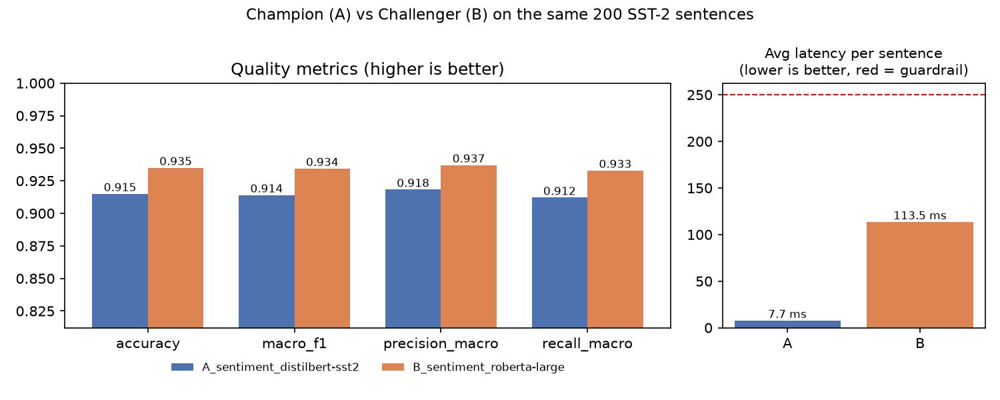
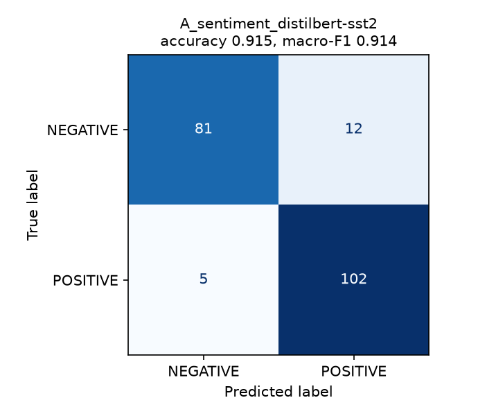
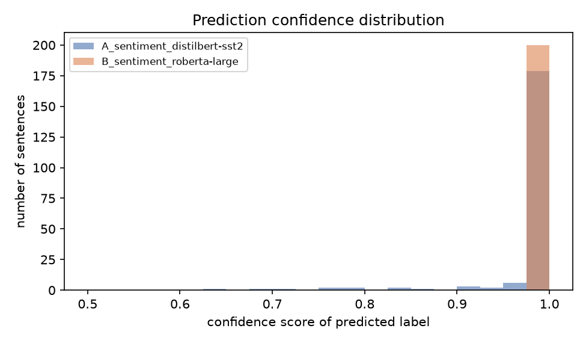
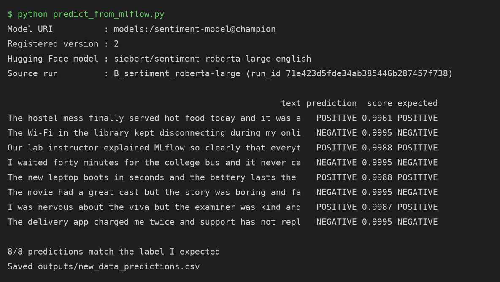
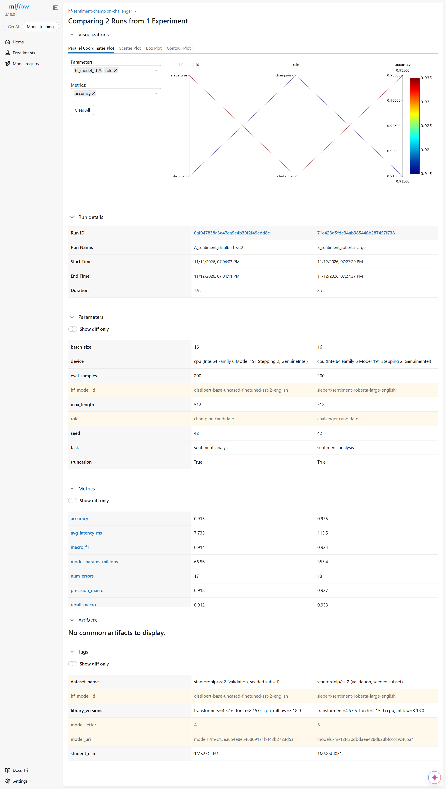
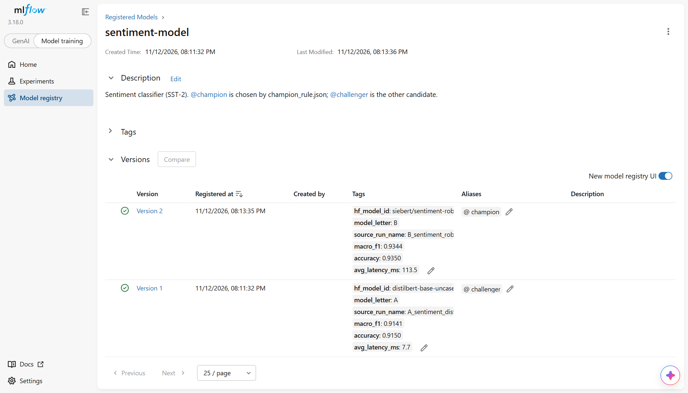

# Champion–Challenger Model Comparison with Hugging Face and MLflow

**Student:** Bhavayraj Singhal · **USN:** 1MS25CI031 · **Course:** Skill Lab – MLOps with MLflow (Mini Project)

## 1. Task and models

| Item | Value |
|---|---|
| Task | Binary sentiment classification (POSITIVE / NEGATIVE) |
| Dataset | SST-2 validation set (`stanfordnlp/sst2`), 200 sentences sampled with seed 42 → `data/eval_inputs.csv` |
| Model A – current Champion | [`distilbert-base-uncased-finetuned-sst-2-english`](https://huggingface.co/distilbert/distilbert-base-uncased-finetuned-sst-2-english) (~67M parameters) |
| Model B – Challenger | [`siebert/sentiment-roberta-large-english`](https://huggingface.co/siebert/sentiment-roberta-large-english) (~355M parameters) |
| New data for Step 5.6 | `data/new_data.csv` – 8 sentences I wrote myself, not taken from SST-2 |
| MLflow experiment | `hf-sentiment-champion-challenger` |
| Registered model | `sentiment-model` with aliases `@champion` and `@challenger` |

Both models output the labels POSITIVE / NEGATIVE, the same labels as SST-2, so no label mapping is needed.

## 2. How to run

Windows (PowerShell), from this folder:

```powershell
python -m venv .venv
.venv\Scripts\Activate.ps1
pip install -r requirements.txt
python -m playwright install chromium

# terminal 1 – tracking server (keep it open)
python -m mlflow server --host 127.0.0.1 --port 5000

# terminal 2
python prepare_data.py          # saves data/eval_inputs.csv (200 SST-2 sentences, seed 42)
python evaluate.py              # runs A and B on the same inputs and logs 3 runs to MLflow
python register_champion.py     # registers both versions and sets @champion / @challenger
python predict_from_mlflow.py   # loads models:/sentiment-model@champion and predicts on data/new_data.csv
python predict_from_mlflow.py --alias challenger   # stretch goal: same script, other alias
python capture_screenshots.py   # saves the 3 screenshots into screenshots/
python write_report.py          # fills the results tables below from outputs/metrics_summary.json
```

`run_all.ps1` (Windows) and `run_all.sh` (macOS / Linux) run all of these steps in order and start the server for you. Open http://127.0.0.1:5000 to see the runs.

## 3. Champion rule (written before the final run)

This rule was fixed before any model was evaluated and is stored in `champion_rule.json`, which `evaluate.py` reads. It was committed to the repository before the first evaluation run.

1. **Primary metric:** macro-F1 on the 200 evaluation sentences. **Higher is better.** Macro-F1 gives equal weight to the positive and negative class, so a model cannot score well by favouring one label.
2. **Minimum improvement margin:** the Challenger must beat the Champion by **at least 2 percentage points** of macro-F1. With 200 sentences, one sentence is 0.5 points, so a 2-point gain means about four more sentences classified correctly. Anything smaller is too close to random variation in the sample to justify switching to a model that is five times larger.
3. **Tie-breaker:** if the difference is smaller than 2 points (or the Challenger is worse), the **Champion stays**, because it is the smaller and faster model.
4. **Guardrail:** the Challenger is rejected if its **average latency is above 250 ms per sentence** on the same machine, even if it wins on macro-F1. Above that, a sentiment check would feel slow in an interactive application.
5. **Direction of every metric:** accuracy, macro-F1, macro precision and macro recall – higher is better; `avg_latency_ms` and `total_inference_s` – lower is better.

The decision is logged in the `compare_sentiment` run as the parameters `primary_metric` and `margin`, the metric `delta_primary_metric` (Challenger minus Champion) and the tag `winner`.

## 4. Results

<!-- RESULTS_START -->
Run on cpu (Intel64 Family 6 Model 191 Stepping 2, GenuineIntel) with transformers=4.57.6, torch=2.15.0+cpu, mlflow=3.18.0. All numbers are on the same 200 sentences in `data/eval_inputs.csv`.

| Metric | A – Champion (distilbert-sst2) | B – Challenger (roberta-large) | B − A |
|---|---|---|---|
| Accuracy (%) ↑ | 91.50 | 93.50 | +2.00 |
| **Macro-F1 (%) ↑ – primary** | **91.41** | **93.44** | **+2.04** |
| Macro precision (%) ↑ | 91.83 | 93.71 | +1.88 |
| Macro recall (%) ↑ | 91.21 | 93.29 | +2.08 |
| Wrong predictions (of 200) ↓ | 17 | 13 | -4 |
| Avg latency (ms / sentence) ↓ | 7.7 | 113.5 | × 14.68 |
| Total inference time (s) ↓ | 1.55 | 22.71 | +21.16 |
| Parameters (millions) ↓ | 67 | 355 | × 5.3 |

The two models disagree on 16 of the 200 sentences. On those, only A is right 6 times and only B is right 10 times (exact McNemar test, p = 0.455).



| Confusion matrix – Model A | Confusion matrix – Model B |
|---|---|
|  |  |



**Five sentences where the models disagree** (full list in `outputs/disagreements_all.csv`):

| SST-2 idx | Sentence | Reference | A | B | Comment |
|---|---|---|---|---|---|
| 243 | the film tunes into a grief that could lead a man across centuries . | POSITIVE | NEGATIVE (0.96) | POSITIVE (1.00) | Only B is right; A gave NEGATIVE with confidence 0.96 |
| 683 | true tale of courage -- and complicity -- at auschwitz is a harrowing drama that tries ... | POSITIVE | NEGATIVE (0.69) | POSITIVE (1.00) | Only B is right; A gave NEGATIVE with confidence 0.69 |
| 312 | i 'll bet the video game is a lot more fun than the film . | NEGATIVE | POSITIVE (1.00) | NEGATIVE (1.00) | Only B is right; A gave POSITIVE with confidence 1.00 |
| 646 | the longer the movie goes , the worse it gets , but it 's actually pretty good in the f... | NEGATIVE | POSITIVE (1.00) | NEGATIVE (1.00) | Only B is right; A gave POSITIVE with confidence 1.00 |
| 865 | mcconaughey 's fun to watch , the dragons are okay , not much fire in the script . | POSITIVE | POSITIVE (0.71) | NEGATIVE (1.00) | Only A is right; B gave NEGATIVE with confidence 1.00 |

**Prediction on new data with the Champion** (`outputs/new_data_predictions.csv`):



**MLflow screenshots**





<!-- RESULTS_END -->

## 5. Decision

<!-- DECISION_START -->
**Champion: Model B (roberta-large).** The Challenger improves macro-F1 from 91.41% to 93.44%, a gain of 2.04 points, which is above my 2-point margin, and its average latency of 113.5 ms per sentence is within the 250 ms guardrail. Under the rule fixed before the run, it replaces the Champion.

With only 200 sentences each sentence is worth 0.5 points, and the models disagree on 16 of them (6 won by A, 10 by B). The McNemar test gives p = 0.455, so the difference could easily be chance and a larger test set would be needed to be sure. The trade-off is size and speed: B has about 5× more parameters and was 14.7× slower (113.5 ms against 7.7 ms per sentence), and it needs a much larger download. Model A was fine-tuned on SST-2 itself, which helps it on this data, while B was trained on a wider mix of English reviews and may generalise better to other kinds of text. The disagreement table above shows the sentences where the two models differ.
<!-- DECISION_END -->

## 6. Limitations and declaration

**Limitations**
- Only 200 sentences are used, so each sentence is worth 0.5 percentage points of accuracy. Small differences between the models may not hold on a larger test set.
- SST-2 sentences are short movie-review phrases. Results may differ on other kinds of text, such as tweets, product reviews or Hinglish.
- Latency was measured once, on my laptop, with batches of 16 sentences. It depends on the hardware, the batch size and on other programs running at the same time.
- The models were evaluated as published on the Hugging Face Hub. Model A was itself fine-tuned on the SST-2 training set, which can favour it on this data set.

**Declaration**
- An AI assistant (Claude by Anthropic) was used to help write the code in this repository and to draft this README. The results come from running the code on my own laptop.
- Libraries used: Hugging Face `transformers`, `datasets`, PyTorch, MLflow, scikit-learn, pandas, matplotlib and Playwright (screenshots only). Exact versions are logged in the `library_versions` tag of every run.

## Repository structure

```
README.md                 this report
requirements.txt          libraries
champion_rule.json        the decision rule (fixed before the run)
prepare_data.py           builds data/eval_inputs.csv from SST-2
sentiment_wrapper.py      custom mlflow.pyfunc.PythonModel around the Hugging Face pipeline
evaluate.py               runs both models and logs everything to MLflow
register_champion.py      registers both models and sets the aliases
predict_from_mlflow.py    loads @champion and predicts on new data
capture_screenshots.py    saves the three required screenshots
write_report.py           writes the results and decision sections of this README
run_all.ps1 / run_all.sh  run everything in order
data/                     eval_inputs.csv, new_data.csv
outputs/                  predictions, metrics_summary.json, plots, disagreements, new_data_predictions.csv
screenshots/              compare view, registry aliases, predict_from_mlflow.py output
```
